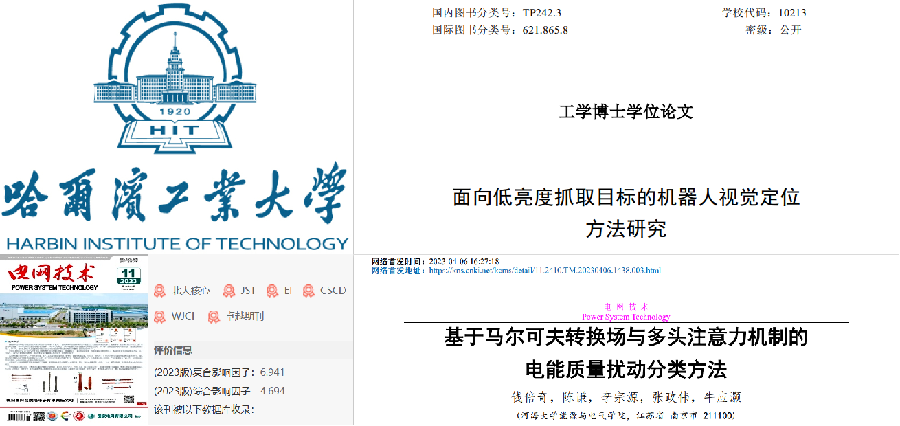
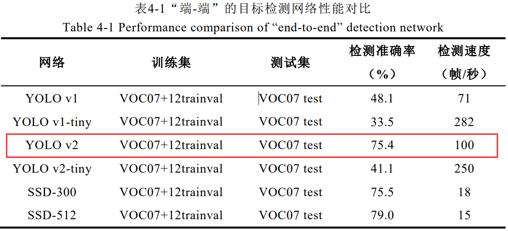
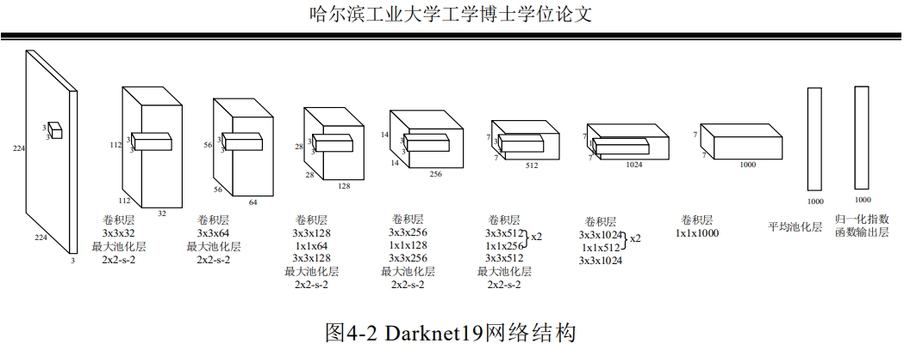
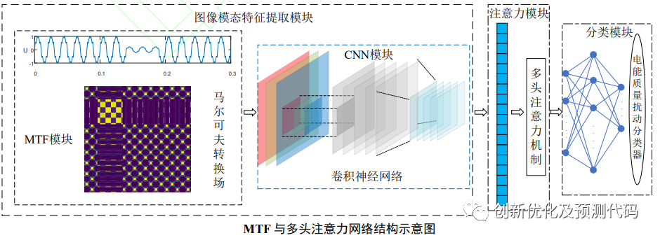
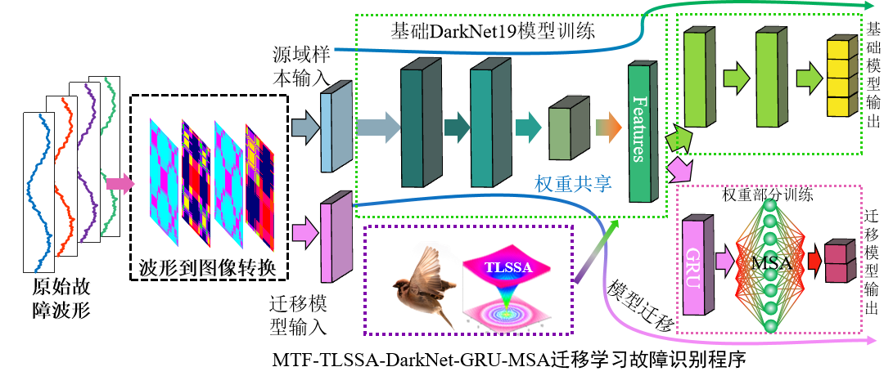
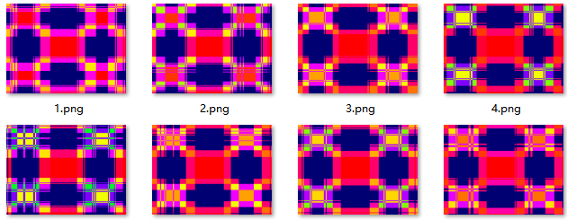
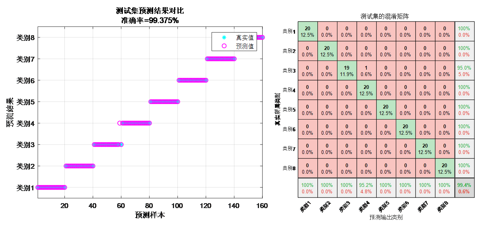
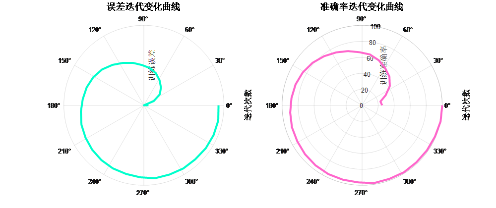
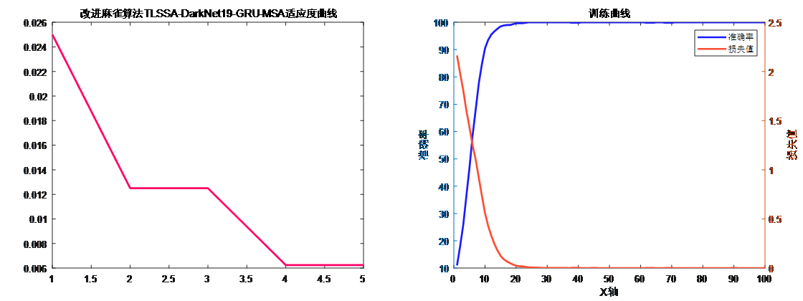

# 3 Top-tier journal improvements! MTF-TLSSA-DarkNet-GRU-MSA transfer learning fault identification program (t distribution + Levy flight improved sparrow optimization)

Applicable Platform: MATLAB 2023 and above.
References:
1. Heilongjiang University PhD Thesis "Research on Robot Vision Localization Method for Low-Brightness Object Capture"
2. Chinese Top EI Journal "China Electric Power Engineering Journal" article "Research on NOx Prediction Based on the Plumage Search Algorithm and Deep Extreme Learning Machine" in the Plumage Search Algorithm.
nolgy
The fault identification model adopts the DarkNet19 model from target detection algorithms combined with transfer learning as the framework of the fault identification model, and is improved based on this to add GRU and multihead self-attention mechanism (MSA) to enhance the model's feature extraction capability;
In terms of data preprocessing, referencing Reference 2, the one-dimensional waveform is transformed into an image using a Markov field;
Regarding the hyperparameters of the DarkNet19-GRU-MSA model, the adaptive t distribution and Levy flight improved plumage search algorithm are used for optimization of TLSSA, that is, the MTF-TLSSA-DarkNet-GRU-MSA fault identification model is proposed.
Improved plumage search algorithm optimization + improved DarkNet19 + GRU + multihead attention mechanism + transfer learning fault identification program: MTF-TLSSA-DarkNet-GRU-MSA transfer learning fault identification program,
Reference 1 interpretation
Work interpretation of Reference 1: Chapter 4 of the reference compares current target detection YOLO models, finding that YOLO v2 network has both high detection accuracy and speed.
YOLOv2 is composed of 19 convolutional layers, 5 max pooling layers, 1 average pooling layer, and a normalization exponential function output layer, which balances computational speed and precision, and is also applicable in the field of fault identification. There has not been anyone doing this in the field of fault identification yet!
Sparse connections: In the convolutional layers of the DarkNet19 network, the connection between neurons is implemented using sparse connections. This connection method not only significantly reduces the number of network parameters but also avoids overfitting during image processing.
Weight sharing: The DarkNet19 network also leverages the weight sharing feature of convolutional neural networks to reduce a large amount of unnecessary network parameter computations in convolution operations, thereby effectively enhancing the computational efficiency of the convolutional layer.
Accelerate convergence: A key feature of the DarkNet19 network's convolutional layer is that after convolution operations, "batch normalization" is employed to improve the stability of the model during training and accelerate convergence. The adoption of batch normalization allows the network to conduct more stable gradient propagation with a larger learning rate, while also enhancing the generalization capability of the network.
Document Two Interpretation 
The innovation point of this document lies in the combination of Markov Field (MTF) and Convolutional Neural Network (CNN), incorporating multi-head attention mechanism for fault classification. MTF converts one-dimensional signals into two-dimensional feature maps, while CNN can perform adaptive feature extraction and classification on these feature maps. The integration of multi-head attention mechanism effectively grasps the contribution level of extracted features, achieving accurate fault classification.
Document Three Interpretation 
This document interprets the application of the Sparrow Optimization Algorithm in deep extreme learning machines, optimizing their parameters to avoid errors caused by manually selected parameters. Building on the SSA Sparrow Search method, this paper proposes a T-distribution and Levy flight improved Sparrow Search method (TLSSA) for hyperparameter optimization of the MTF-DarkNet-GRU-MSA transfer learning fault identification model.
Based on the improved DarkNet19 model from literature one, the MTF Markov Field (MTF) model from literature two, and the SSA optimization algorithm from literature three, we propose a transfer learning fault identification program based on the improved SSA optimization algorithm, MTF (MTF), and an integrated version of DarkNet19 with GRU and multi-head attention mechanism: MTF-TLSSA-DarkNet-GRU-MSA Transfer Learning Fault Identification Program. This program is innovative and robust enough to support high-level academic papers and simple tasks such as graduation projects.
The MTF-TLSSA-DarkNet-GRU-MSA Transfer Learning Fault Identification Program requires only raw fault waveform data. It can convert a one-dimensional sequence into a two-dimensional Markov Field image based on the waveform data.
Starting with the pre-trained DarkNet19 model, we perform model fine-tuning on the new fault identification dataset. Since different research topics and fault categories exist, it is necessary to freeze some layers of the pre-trained DarkNet19 model.
We improve the output layer by adding a GRU network and a multi-head self-attention mechanism MSA layer, retraining these layers to adapt to the new classification task. The structure of our model is shown in the figure below.
There are seven major innovations:
1. Time series visualization: Converting a one-dimensional time series signal into a two-dimensional image helps to describe the data more comprehensively. This facilitates the extraction of richer and more discriminative features, thereby improving the accuracy of classification and recognition.
2. Transfer learning: Fully leveraging the pre-trained DarkNet19 model on large datasets for model fine-tuning, standing on the shoulders of giants, drawing upon the strengths of many models, and applying transfer learning to fine-tune the model for fault identification tasks, demonstrating strong feature extraction capabilities.
3. Low training time: The DarkNet19 focuses on training the weighted parts of the model for fine-tuning, maintaining low computational complexity, which is beneficial for real-time applications.
4. Multi-Head Self-Attention Mechanism: This mechanism effectively captures the contribution of features by integrating multi-head attention mechanisms (MSA), enhancing feature emphasis and improving the accuracy of fault identification.
5. Superparameter Optimization: The Improved Sparrow Optimization Algorithm (TLSSA) is used to optimize parameters in the model, such as difficult-to-determine learning rates and the number of GRU layer neurons, making the model structure more reasonable and increasing the accuracy of fault identification.
6. Optimization Algorithm Improvement: Adaptive t-distribution and dynamic selection strategy are employed. A t-distribution mutation operator that uses the iteration count as the degree parameter for t-distribution is used to perturb the sparrow's position, enabling the algorithm to have good global exploration capability in the early iteration stages and good local exploration capability in the later iteration stages, and improving the convergence speed of the algorithm.
7. Levy Flight Strategy: In this paper, Levy flight is applied to the position update of the sparrow. After updating the algorithm, a Levy flight update is performed to update the individual's position, achieving the effect of breaking out of local optima and expanding search capabilities.
Applicable Fields: Suitable for various data classification scenarios, such as rolling bearing faults, transformer oil gas faults, power system transmission line fault areas, insulators, distribution networks, and disturbances in electric power quality, etc., for recognition, diagnosis, and classification.
Data Format: One fault waveform sample per row, with the last column being the fault type label of the sample.
Program Results: (Automatically converted from the above one-dimensional sequence into a Markov MTIF image)
Program Results:
Follow the editor regularly for high-quality innovative learning materials, articles, and code updates, fueling your research efforts!

## Images

<!-- PAYMENT_BLOCK -->

## Get this dataset

- Payment link (Stripe): [Buy now](https://buy.stripe.com/3cs8yP7sY87d0vu9AB)
- Payment QR code: 

<!-- /PAYMENT_BLOCK -->
